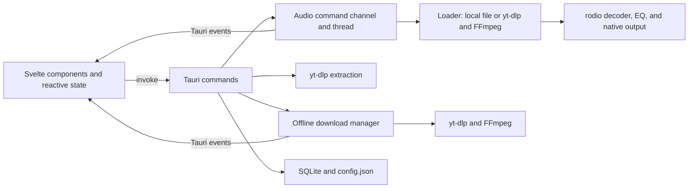

# Architecture

Sunder is a desktop YouTube music client with a Svelte 5 interface in a
Tauri 2 webview and a Rust backend. The frontend manages navigation and the
playback queue; Rust handles native audio, extraction processes, and local
persistence. Audio is prepared as local MP3 files before native playback.

## Frontend organization and state

- [src/main.ts](../src/main.ts) mounts [App.svelte](../src/App.svelte),
  which composes the main views, initializes listeners, loads settings and the
  saved queue, and handles keyboard shortcuts.
- [components/](../src/lib/components/) contains views and controls.
  [state/](../src/lib/state/) exports shared state objects using Svelte 5
  runes such as `$state` and `$derived`.
- [player.svelte.ts](../src/lib/state/player.svelte.ts) owns the queue,
  current track, repeat/shuffle behavior, and lazy playlist context. It
  materializes playlist tracks as needed and requests prefetching.
- [config.svelte.ts](../src/lib/state/config.svelte.ts) loads backend settings
  and debounces persistence of volume, EQ, queue IDs/index, repeat mode, and
  playback speed. Lazy playlist context is stored separately in webview
  `localStorage` by the player state.

## Rust backend and Tauri IPC

[main.rs](../src-tauri/src/main.rs) calls [lib.rs](../src-tauri/src/lib.rs),
where the Tauri builder registers plugins, initializes managed services, sets
up the tray, and registers commands. Managed services include `AudioHandle`,
`Extractor`, `SearchCache`, `DownloadManager`, `ConfigManager`, and Discord
presence.

[bridge.ts](../src/lib/ipc/bridge.ts) wraps frontend `invoke` calls and listens
for backend events. [commands.rs](../src-tauri/src/ipc/commands.rs) implements
the Rust command handlers. Data crosses this boundary through serializable
Rust [models](../src-tauri/src/models.rs) and frontend
[types](../src/lib/types/index.ts). Some state modules also invoke commands
directly; the bridge additionally performs frontend lyrics-service requests.

Playback updates use `playback-progress`, `download-progress`,
`playback-error`, and `track-finished` events. The frontend handles
`track-finished` by selecting the next queue track. Tray/media-control
`media-next`, `media-previous`, and `media-toggle` events use the same bridge.

## Extraction and playback pipeline

1. The bridge invokes `play_track`. The handler looks up track metadata in
   SQLite, falls back to the extractor if needed, and sends audio commands.
2. [audio/engine.rs](../src-tauri/src/audio/engine.rs) owns a dedicated audio
   thread and an `mpsc` command channel. Loader threads prepare tracks without
   blocking that command loop; session IDs prevent stale preparation results
   from replacing a newer track.
3. Preparation prefers a persistent offline MP3, then a temporary cached MP3.
   Otherwise it runs yt-dlp with `--extract-audio --audio-format mp3`, using
   FFmpeg for conversion. Playback starts from the resulting file rather than
   streaming a remote URL directly into the decoder.
4. rodio decodes the file through [EqSource](../src-tauri/src/audio/equalizer.rs)
   and native audio output. On Linux, device selection tries native PipeWire,
   then the ALSA `pulse` device, then rodio's default output. The engine also
   handles seeking, speed, device recovery, and souvlaki media controls.

[extraction/sidecar.rs](../src-tauri/src/extraction/sidecar.rs) runs yt-dlp for
search, metadata, playlist import, and subtitles. The normal search command
combines local SQLite results with YouTube results and deduplicates track IDs;
YouTube Music search is used for Explore seeds.
[extraction/ytdlp.rs](../src-tauri/src/extraction/ytdlp.rs) resolves the binary
in this order: `SUNDER_YTDLP_PATH`, an executable app-managed copy, then PATH.
It also implements the opt-in Linux updater.

[downloads.rs](../src-tauri/src/downloads.rs) handles persistent downloads
separately from playback preparation. It deduplicates in-flight requests,
limits concurrent downloads to three, records completed files in SQLite, and
emits `track-download` events. Prefetching in the IPC commands prepares MP3s
in the temporary playback cache.

## Database and persistent storage

The backend resolves Tauri's app-data directory for the identifier in
[tauri.conf.json](../src-tauri/tauri.conf.json), with a `sunder_data` directory
under the working directory as the initialization fallback.

| Storage | Owner and contents |
| --- | --- |
| `<app-data>/sunder.db` | [db/cache.rs](../src-tauri/src/db/cache.rs): a mutex-protected rusqlite connection using WAL; tracks, FTS5 search index, playlists and ordering, listening history, lyrics/offsets, and download records |
| `<app-data>/config.json` | [config.rs](../src-tauri/src/config.rs): serialized `AppConfig`, including playback settings and saved queue IDs/index |
| `<app-data>/downloads/<track-id>.mp3` | Persistent offline audio managed by `DownloadManager` |
| `<app-data>/bin/yt-dlp` | Optional app-managed extraction tool |
| `<system-temp>/sunder/` | Temporary playback/prefetch MP3 cache, separate from offline downloads |

Schema creation and migrations live in `SearchCache::new`. Queue track
details are restored from SQLite using the IDs saved in configuration.

## Where to make common changes

| Change | Start here |
| --- | --- |
| Views, controls, navigation | [components/](../src/lib/components/), [nav.svelte.ts](../src/lib/state/nav.svelte.ts), and `App.svelte` |
| Queue, repeat, shuffle, playlist continuation | `player.svelte.ts` and `bridge.ts` |
| IPC operation or payload | `bridge.ts`, `commands.rs`, command registration in `lib.rs`, and Rust/frontend types |
| Search or yt-dlp behavior | `commands.rs` and [extraction/](../src-tauri/src/extraction/) |
| Playback, EQ, or output devices | [audio/](../src-tauri/src/audio/) |
| Offline downloads | `downloads.rs`, download commands, and [downloads.svelte.ts](../src/lib/state/downloads.svelte.ts) |
| Stored data or settings | `db/cache.rs`, `config.rs`, and `config.svelte.ts` |

Follow [CONTRIBUTING.md](../CONTRIBUTING.md) and keep changes focused on one
feature or fix.
